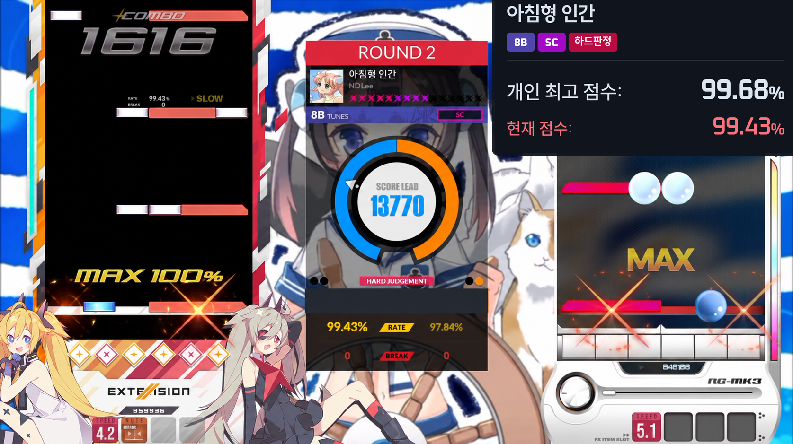

# DJMAXLocalRecords

DJMAX RESPECT V 게임에서 따로 관리하지 않는 **하드·맥스판정의 개인 최고 기록**을 노말판정과 구분해 저장할 수 있는 Windows 프로그램입니다.

게임 화면에서 SCORE를 읽고, 확인한 점수를 내 PC에 저장합니다. OBS를 연결하면 플레이 중에 현재 RATE와 같은 패턴·판정의 개인 최고 기록을 비교할 수 있습니다. 기록 저장과 조회는 OBS 없이도 가능합니다.

**[다운로드](https://github.com/Zionee148/DJMAXLocalRecords/releases) · [사용 방법](guide/usage.md) · [v1.2.0 패치노트](guide/release-notes/v1.2.0.md) · [오류 제보](https://github.com/Zionee148/DJMAXLocalRecords/issues)**

   
  왼쪽에서 감지를 시작하면 오른쪽에 곡 정보와 점수가 표시됩니다.

   
  래더에서는 하드판정의 개인 최고 기록을 따로 볼 수 있습니다.

   
  프리스타일에서 현재 RATE와 같은 패턴의 개인 최고 기록을 비교합니다.

## 주요 기능

- **SCORE 인식·등록** — 마지막 노트가 끝난 뒤 등록 키를 누르면 화면에서 SCORE를 읽습니다. 메인 창이나 오버레이에서 점수를 확인한 뒤 저장할 수 있습니다.
- **플레이 히스토리** — 최고 기록을 경신하지 못한 판도 저장할 수 있습니다. 패턴별 점수 변화를 표와 그래프로 확인할 수 있습니다.
- **컬렉션 가져오기** — 게임의 MUSIC DATA에서 버튼·난이도별 최고 SCORE를 읽어 노말판정 기록으로 가져옵니다.
- **V아카이브 가져오기** — 닉네임으로 노말판정 기록을 불러오고, 가져올 점수를 미리 확인할 수 있습니다.
- **OBS 오버레이** — 플레이 중 현재 RATE와 개인 최고 기록을 함께 표시합니다. 투컴 방송에서는 같은 네트워크에 있는 송출 PC의 OBS에 오버레이를 띄울 수 있습니다.

## 시작하기

1. [릴리즈 페이지](https://github.com/Zionee148/DJMAXLocalRecords/releases)의 **Assets**에서 이름이 `-win-x64.zip`으로 끝나는 파일을 내려받아 새 폴더에 압축을 풀고 `DJMAXLocalRecords.exe`를 실행합니다.
2. Steam과 DJMAX RESPECT V를 실행한 뒤, 프로그램에서 **게임 창**, **기어 위치**, **기록 프로필**을 선택합니다.
3. 곡을 시작하기 전에 <strong>감지 시작(Ctrl+F12)</strong>을 누릅니다.
4. 마지막 노트가 끝나고 **결과 화면으로 넘어가기 전**, 최종 SCORE가 보일 때 <strong>등록(Ctrl+F8)</strong>을 누릅니다.
5. 메인 창이나 오버레이에서 곡과 점수를 확인한 뒤 **Ctrl+F10**으로 저장하거나 **Ctrl+F11**로 취소합니다.

## 지원 환경

| 항목 | 사용 조건 |
| --- | --- |
| 운영체제 | Windows 11 x64 |
| 게임 화면 | 1920×1080(16:9) 창모드를 기준으로 검증했으며, 전체화면에서도 동작을 확인했습니다. |
| Windows 화면 배율 | 100% · 125% · 150% |
| 기어 위치 | 검증한 기어의 LEFT · CENTER · RIGHT |
| 컬렉션 가져오기 | 게임 언어는 한국어로 설정합니다. 2560×1440처럼 모니터 해상도가 더 높아도 **게임 옵션에서 해상도를 1920×1080으로 설정해야 합니다.** |

- 인식 중에는 **게임 화면 전체가 가려지지 않아야 합니다.** 1920×1080보다 작은 화면에서는 점수를 읽기 어려울 수 있습니다.
- Windows 10과 21:9 화면은 아직 검증하지 않았습니다.
- 컬렉션 가져오기는 모니터가 16:9가 아니면 창모드로 실행합니다. 2560×1440보다 큰 모니터에서는 아직 확인하지 않았습니다.
- 새로 지원하는 악곡·SC 패턴과 기어 변경 사항은 버전별 패치노트에서 안내합니다.

## 관련 안내

[사용 방법](https://github.com/Zionee148/DJMAXLocalRecords/blob/main/guide/usage.md) · [업데이트·복구](https://github.com/Zionee148/DJMAXLocalRecords/blob/main/guide/update.md) · [문제 해결·오류 제보](https://github.com/Zionee148/DJMAXLocalRecords/blob/main/guide/troubleshooting.md) · [개발자 안내](https://github.com/Zionee148/DJMAXLocalRecords/blob/main/guide/development.md) · [라이선스·출처](https://github.com/Zionee148/DJMAXLocalRecords/blob/main/guide/license.md)
