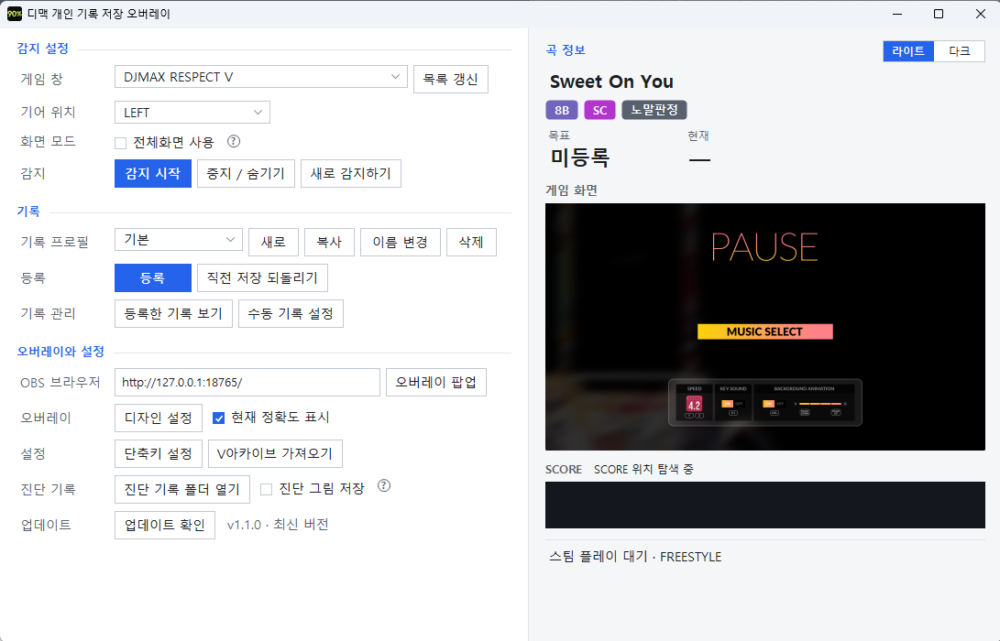

# DJMAXLocalRecords

DJMAX RESPECT V의 개인 기록을 관리하는 Windows 프로그램입니다. **게임에서 따로 관리되지 않는 하드·맥스 판정의 최고 기록을 노말과 구분하여 관리할 수 있습니다.**

게임 화면의 SCORE를 읽어 사용자 확인 후 기록을 저장하고, OBS 오버레이로 보여줍니다. OBS 없이도 기록 관리 기능을 사용할 수 있습니다.

**[다운로드](https://github.com/Zionee148/DJMAXLocalRecords/releases) · [사용 안내](guide/usage.md) · [오류 제보](https://github.com/Zionee148/DJMAXLocalRecords/issues)**

   
  게임 감지와 기록 관리, OBS 오버레이 설정을 한 화면에서 조작합니다.

   
  래더 하드 판정의 최고 기록을 따로 관리하고, OBS 오버레이로 표시합니다.

   
  프리스타일에서 개인 최고 기록과 현재 RATE를 함께 확인합니다.

## 주요 기능

- **SCORE 인식·등록** — 게임 화면의 점수를 읽고, 사용자 확인 후 기록을 저장합니다.
- **기록 관리** — 프로필별 최고 기록을 관리하고, 검색·수동 수정·되돌리기를 지원합니다.
- **V아카이브 가져오기** — V아카이브 기록을 가져와 함께 관리합니다.
- **OBS 오버레이** — 곡 정보·최고 기록·현재 RATE·등록 결과를 표시하며, 디자인을 설정할 수 있습니다.
- **자동 업데이트** — 새 버전을 안내하고, 사용자 선택에 따라 백업 후 업데이트합니다.

## 시작하기

1. [릴리즈 페이지](https://github.com/Zionee148/DJMAXLocalRecords/releases)에서 **Windows x64용 ZIP**을 내려받아 압축을 풉니다.
2. Steam과 게임을 켜고, `DJMAXLocalRecords.exe`를 실행합니다.
3. 프로그램에서 **게임 창·기어 위치·프로필**을 선택합니다.
4. <strong>감지 시작(Ctrl+F12)</strong>을 누른 뒤 플레이합니다.
5. 곡이 끝나고 **결과 화면으로 넘어가기 전**, 최종 SCORE가 보일 때 <strong>등록(Ctrl+F8)</strong>을 누릅니다.
6. 인식한 곡 정보와 점수를 확인하고 **저장 확인(Ctrl+F10)** 또는 <strong>저장 취소(Ctrl+F11)</strong>를 누릅니다.

전체화면으로 플레이할 때는 프로그램의 **전체화면 사용**을 켭니다.

## 지원 환경

| 항목 | 검증한 환경 |
| --- | --- |
| 운영체제 | Windows 11, x64 |
| 게임 화면 | 1920×1080, 16:9 — 창모드·전체화면 |
| Windows 배율 | 100%·125%·150% |
| 기어 위치 | 검증한 기어의 LEFT·CENTER·RIGHT |

- 인식 중에는 **게임 화면이 가려지지 않고 온전히 보여야 합니다.**
- Windows 10, 21:9, 그 밖의 해상도·배율은 미검증입니다. 기준보다 작은 게임 화면에서는 인식이 불안정할 수 있습니다.
- 지원 기어의 추가·변경 사항과 추가 악곡·SC 패턴의 지원 내역은 **버전별 패치노트**에서 안내합니다.

## 관련 안내

| 안내 | 내용 |
| --- | --- |
| [사용 방법](guide/usage.md) | 초기 설정, 기록 등록·관리, OBS 연결과 디자인 설정 |
| [업데이트·복구](guide/update.md) | 새 버전 설치, 기존 기록 이전, 이전 버전 복구 |
| [문제 해결·오류 제보](guide/troubleshooting.md) | 인식 오류 확인, 진단 자료 저장과 제보 방법 |
| [개발자 안내](guide/development.md) | 소스 구성, 빌드 방법, 검사 도구 사용법 |
| [라이선스·출처](guide/license.md) | 자체 코드의 MIT 라이선스, 외부 라이브러리와 자료의 이용 조건·출처 |
