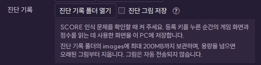

# 문제 해결·오류 제보

## 1. 먼저 확인하기

| 증상 | 확인할 내용 |
| --- | --- |
| 곡 정보가 뜨지 않습니다. | Steam과 게임이 실행 중인지 확인합니다. 메인 창에서 DJMAX RESPECT V 창을 선택하고 **새로 감지하기**를 누릅니다. 기본 단축키는 **Ctrl+F9**입니다. |
| SCORE 위치를 찾지 못합니다. | 프로그램의 **기어 위치**를 게임 설정과 맞춥니다. 게임 창이 최소화되거나 다른 창에 가려지지 않았는지 확인합니다. |
| 점수를 확인할 수 없다고 나옵니다. | 메인 창 오른쪽 아래에서 실패 사유를 확인합니다. 플레이 중 읽은 점수가 부족하면 이번 판은 **수동 기록 설정**에서 입력하고, 다음 곡은 시작 전에 감지를 켭니다. |
| 등록할 곡이나 점수가 잘못 표시됩니다. | 저장 전이면 **취소**를 누릅니다. 방금 저장했다면 **직전 저장 되돌리기**를 누릅니다. 이후 다른 기록도 저장했다면 **기록 히스토리**에서 점수는 **선택 기록 수정**으로 고칩니다. 곡이나 패턴이 틀렸으면 **선택 기록 삭제**로 지운 뒤 **수동 기록 설정**에서 다시 저장합니다. |
| 단축키가 작동하지 않습니다. | **단축키 설정**에서 키 조합과 충돌 안내를 확인합니다. 다른 프로그램이 같은 키를 사용하면 한쪽의 키 조합을 바꿉니다. |
| 원컴 방송에서 오버레이가 보이지 않습니다. | 감지가 켜져 있는지, 메인 창의 **OBS 브라우저** 주소와 OBS 브라우저 소스의 URL이 같은지 확인합니다. OBS 장면에서 해당 소스의 눈 아이콘도 확인합니다. |
| 송출 PC에서만 오버레이가 보이지 않습니다. | 두 PC가 같은 공유기에 연결되어 있는지 확인하고, 게임 PC에서 **투컴 연결 허용**을 켭니다. **송출 PC용 주소**를 다시 복사하고 메신저 등으로 송출 PC에 옮긴 뒤 송출 PC의 웹 브라우저에서 열어 봅니다. 열리면 같은 주소를 OBS에 입력합니다. 연결되지 않으면 주소 옆의 **연결이 안 될 때**를 확인합니다. |
| 업데이트나 복구 후 기록이 보이지 않습니다. | 실행한 버전과 선택한 프로필을 확인합니다. v1.1.0은 실행 파일 옆의 기록을, v1.2.0은 `UserData`의 기록을 사용합니다. 파일을 옮기기 전에 두 위치를 모두 백업합니다. 자세한 내용은 [업데이트·복구 안내](update.md)를 봅니다. |
| 게임을 종료했는데 Steam에 실행 중으로 표시됩니다. | 게임과 연결했던 DJMAXLocalRecords를 종료합니다. |

### 컬렉션 가져오기가 시작되지 않거나 중간에 멈출 때

| 증상 | 해결 방법 |
| --- | --- |
| **컬렉션 가져오기** 창이 열리지 않습니다. | 진행 중인 점수 확인이나 저장 확인을 마치고, **중지 / 숨기기**로 감지를 멈춘 뒤 다시 엽니다. |
| **Ctrl+Enter**를 눌러도 시작되지 않습니다. | 게임 창을 앞으로 가져오고 **COLLECTION → PLAY INFO → MUSIC DATA**에서 필터를 **ALL**로 맞춥니다. 게임을 관리자 권한으로 실행했다면 일반 권한으로 다시 실행합니다. |
| 다른 프로그램이 단축키를 사용 중이라고 나옵니다. | **Ctrl+Enter**가 겹치면 해당 프로그램을 닫고 **컬렉션 가져오기** 창을 다시 엽니다. **Backspace**가 겹치면 해당 프로그램을 닫은 뒤 게임에서 **Ctrl+Enter**를 누릅니다. |
| 화면을 찾지 못하거나 검수할 항목이 너무 많습니다. | 게임 언어를 **한국어**로, **게임 옵션의 해상도를 1920×1080**으로 설정합니다. 모니터가 16:9가 아니면 창모드로 실행합니다. 게임 화면 전체가 보이게 하고 커서를 곡명과 점수표 밖으로 옮깁니다. HDR을 사용 중이면 끈 뒤 다시 시도합니다. |
| 다른 창으로 전환하거나 필터를 바꾼 뒤 읽기가 멈췄습니다. | 게임으로 돌아가 필터를 **ALL**로 맞추고 **Ctrl+Enter**를 누릅니다. 첫 곡부터 다시 읽으며, 중단된 내용은 기존 기록에 반영되지 않습니다. |
| 곡이나 패턴을 찾을 수 없습니다. | 판독 검수의 후보에 곡이 없으면 <strong>전체 곡에서 찾기…</strong>로 검색합니다. 그래도 곡이 없거나 미등록 패턴 안내가 뜨면 가져오기 창을 닫고 메인 창의 **업데이트 확인**을 누릅니다. |

## 2. 진단 자료 남기기

진단 로그는 내 PC에 자동으로 저장됩니다. 점수를 잘못 읽은 화면도 남기려면 다음과 같이 합니다.

1. 메인 창에서 **진단 그림 저장**을 켭니다.
2. 같은 문제가 생기면 평소처럼 <strong>등록(Ctrl+F8)</strong>을 누릅니다. 잘못 읽은 점수는 저장을 취소해도 진단 그림이 남습니다.
3. **진단 기록 폴더 열기**를 누릅니다. 그림은 `images` 폴더에서 확인할 수 있습니다. 필요한 그림을 남겼다면 **진단 그림 저장**을 꺼도 됩니다.

   
  진단 그림 저장 옆의 도움말에서 저장되는 화면과 보관 용량을 확인합니다.

**진단 폴더의 로그 파일은 지워도 됩니다.** `score-0001.log` 같은 파일을 삭제해도 플레이 기록과 설정은 유지됩니다. 오류를 제보할 예정이라면 삭제하기 전에 진단 폴더를 ZIP으로 압축해 보관합니다.

## 3. 오류 제보하기

[GitHub Issues](https://github.com/Zionee148/DJMAXLocalRecords/issues)에 **프로그램 버전, 발생 시각, 증상**을 적어 주세요. 오류 문구가 떴다면 그대로 적고, 어떤 조작을 했을 때 문제가 생겼는지도 알려 주세요.

| 문제 | 함께 보내면 도움이 되는 내용 |
| --- | --- |
| 점수 인식·등록 | 게임 해상도와 창모드 여부, Windows 화면 배율, 기어 이름·위치, 곡명·버튼·난이도·판정 |
| 컬렉션 가져오기 | 멈춘 화면이나 곡명, 그때 표시된 안내 문구 |
| 업데이트·복구 | 프로그램 폴더의 `update/update.log` 파일 |

진단 ZIP이나 화면 캡처가 있으면 첨부해 주세요. 진단 자료는 자동으로 전송되지 않으며, 자료 없이 증상만 제보해도 됩니다. 첨부 파일은 공개되므로 닉네임이나 송출 PC용 주소가 보이는지 먼저 확인해 주세요.
