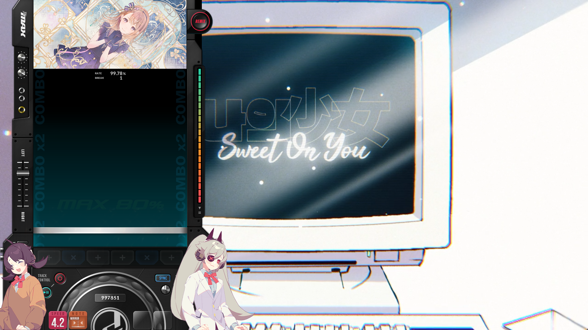
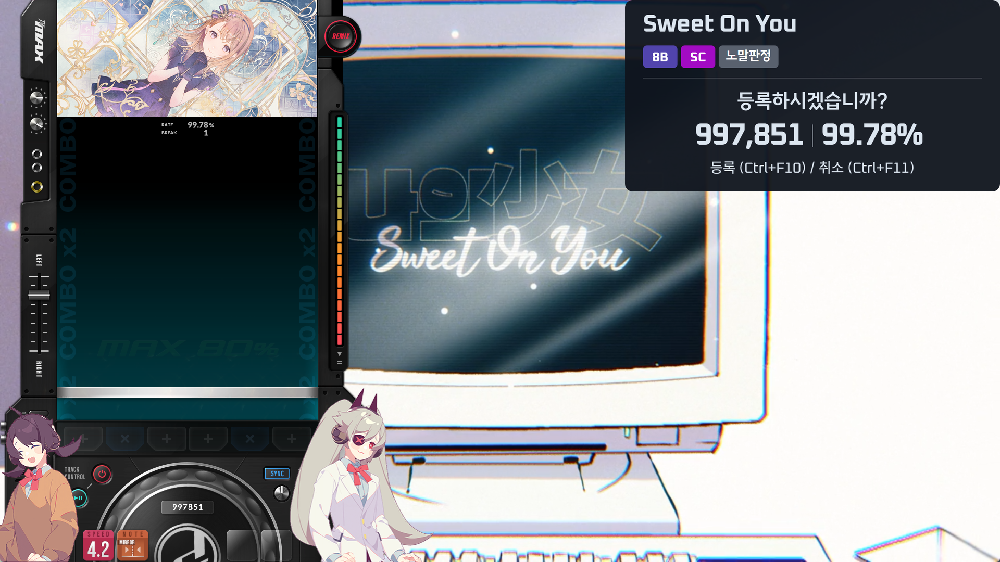
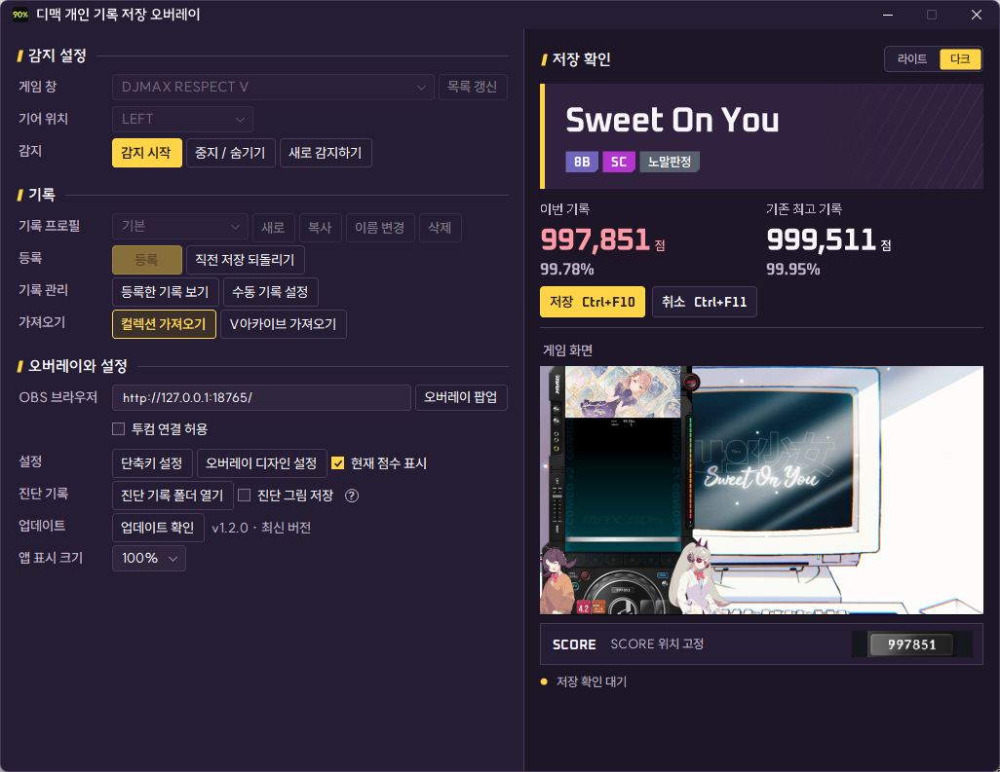
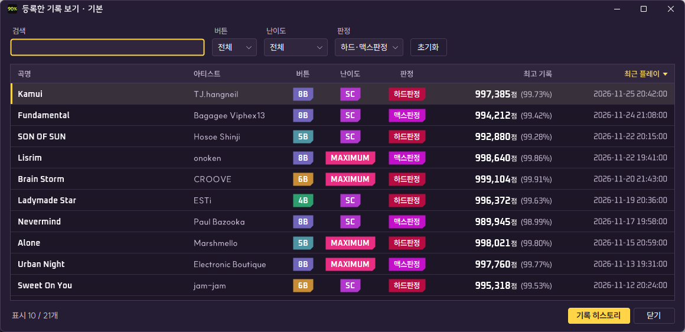
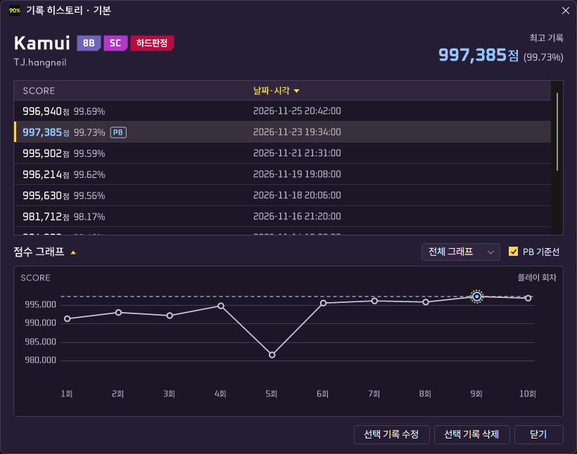
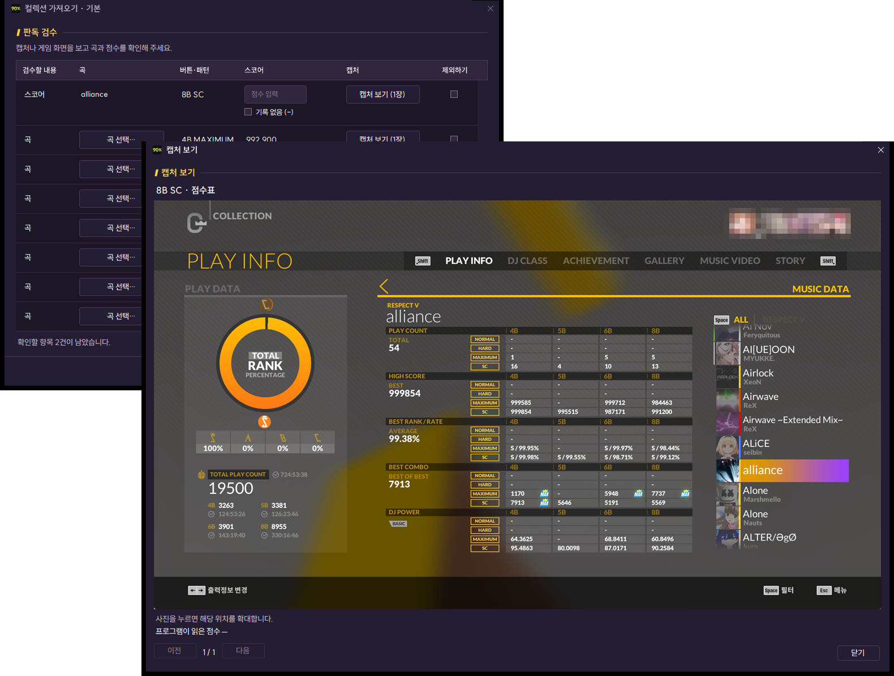
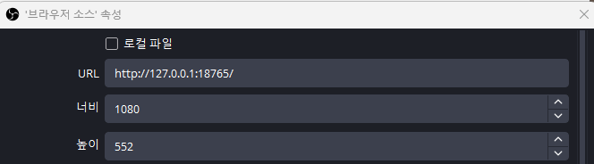
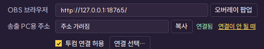
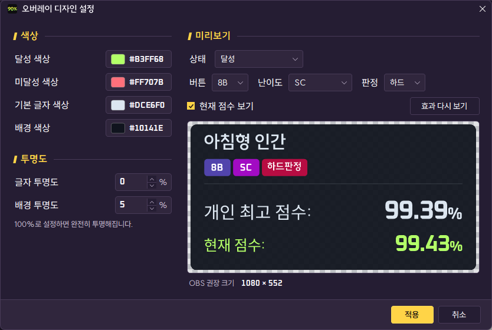

# 사용 방법

## 1. 게임 연결하기

1. 내려받은 ZIP 파일을 새 폴더에 풀고 `DJMAXLocalRecords.exe`를 실행합니다. Steam과 DJMAX RESPECT V도 실행합니다.
2. **게임 창**에서 DJMAX RESPECT V를 선택합니다. 목록에 없으면 **목록 갱신**을 누릅니다.
3. **기어 위치**를 게임에서 사용하는 위치(LEFT·CENTER·RIGHT)에 맞추고, 기록을 저장할 **기록 프로필**을 선택합니다. 처음에는 기본 프로필을 그대로 사용해도 됩니다.
4. 첫 곡을 시작하기 전에 <strong>감지 시작(Ctrl+F12)</strong>을 누릅니다. 플레이 중에 읽은 점수도 등록에 사용하므로, 게임 창을 최소화하거나 다른 창으로 가리지 않도록 합니다.

## 2. 플레이 기록 저장하기

1. 마지막 노트가 끝나고 **결과 화면으로 넘어가기 전**, 플레이 화면에 최종 SCORE가 보일 때 <strong>등록(Ctrl+F8)</strong>을 누릅니다.
2. 메인 창 오른쪽이나 OBS 오버레이에서 **곡명·버튼·난이도·판정**이 맞는지, 표시된 **SCORE와 RATE**가 최종 점수와 일치하는지 확인합니다.
3. 맞으면 **Ctrl+F10**으로 저장하고, 다르면 **Ctrl+F11**로 취소합니다. 메인 창의 **저장** 또는 **취소** 버튼을 눌러도 됩니다.

점수를 읽지 못하면 메인 창 오른쪽 아래에서 실패 사유와 다음 행동을 확인할 수 있습니다. 이미 결과 화면으로 넘어갔다면 **수동 기록 설정**에서 점수를 입력합니다.

   
  이 화면에서 최종 SCORE가 보일 때 등록을 누릅니다.

   
  게임을 앞에 둔 채 오버레이에서 점수를 확인하고 단축키로 저장할 수 있습니다.

   
  같은 점수를 메인 창에서도 확인하고 저장할 수 있습니다.

## 3. 기록 목록과 플레이 히스토리

**등록한 기록 보기**에서 곡을 검색하거나 버튼·난이도·판정으로 목록을 좁힙니다. 패턴·판정별 **최고 기록**과 **최근 플레이 시각**을 볼 수 있습니다. 기록을 더블클릭하거나 선택한 뒤 **기록 히스토리**를 누르면 저장한 판을 하나씩 확인할 수 있습니다.

   
  목록에서 패턴을 고르면 그 판정의 플레이 히스토리를 열 수 있습니다.

- **표**는 최신순입니다. 열 제목 **SCORE**를 누르면 점수순으로 정렬됩니다. 최고점이 같은 판이 여러 개면 가장 최근 판에 <strong>PB(개인 최고 기록)</strong>가 표시됩니다.
- **그래프**는 플레이한 순서대로 점수를 보여줍니다. 점을 누르면 표에서 해당 판이 선택됩니다. **PB 근처 확대**로 최고점 주변의 점수 차이를 자세히 볼 수 있습니다.
- **일시 미상 기록**은 그래프 아래에 점수와 출처가 표시되며, 플레이 회차에서 제외됩니다. 최고점이 일시 미상 기록에만 있으면 표 맨 아래에도 표시됩니다.

   
  점 하나를 누르면 표에서 해당 판의 점수와 시각을 확인할 수 있습니다.

한 판을 고치거나 지우려면 **선택 기록 수정** 또는 **선택 기록 삭제**를 누릅니다. 직접 저장한 판과 세부 SCORE가 남은 이전 기록은 수정·삭제할 수 있습니다. 가져온 기록과 RATE만 남은 이전 기록은 삭제만 가능합니다.

래더 본매치의 하드·맥스판정 점수가 그때의 노말 최고 기록보다 높으면 노말판정에도 반영됩니다. 원래 판정에서 수정·삭제하면 노말판정에도 적용되고, 노말판정에서 삭제하면 원래 하드·맥스판정 기록은 그대로 남습니다.

## 4. 수동 입력과 되돌리기

**수동 기록 설정**에서 곡을 검색하고 버튼·난이도·판정을 선택합니다. SCORE와 RATE는 함께 바뀌므로 둘 중 하나만 입력하면 됩니다. 게임에 표시된 SCORE를 알면 그 값을 입력합니다.

| 하려는 일 | 방법 |
| --- | --- |
| 새 플레이 저장 | 점수를 입력하고 **저장**을 누릅니다. 최고점보다 낮아도 한 판으로 남습니다. |
| 지난 플레이 저장 | **저장 시각 사용**을 해제하고 플레이한 날짜와 시각을 입력합니다. 현재보다 늦은 시각은 입력할 수 없습니다. |
| 최근 판의 오인식 수정 | **최근 플레이 1건을 입력한 점수로 교체**를 선택합니다. 옆에 표시된 점수와 시각을 확인한 뒤 저장하면, 같은 패턴·판정에서 직접 저장한 최근 판의 점수만 바뀌고 원래 플레이 시각은 유지됩니다. |
| 연습·무효 매치 기록 | 새 판을 저장할 때 **래더 연습 모드 · 무효 처리된 매치**를 선택하면 하드·맥스판정 점수는 해당 판정에만 반영됩니다. |
| 가져온 기록 일괄 삭제 | 창 아래의 **V아카이브 삭제** 또는 **컬렉션 삭제**를 누르고, 현재 프로필 이름과 삭제할 건수를 확인합니다. |

되돌리려면 메인 창에서 **직전 저장 되돌리기**를 누르고 되돌릴 내용을 확인합니다. 프로필마다 최근 **20개 작업**을 최신순으로 되돌릴 수 있습니다. 여러 기록을 한꺼번에 가져오거나 삭제한 경우에도 한 번에 되돌립니다.

## 5. 컬렉션 가져오기

게임 컬렉션의 **버튼·난이도별 최고 SCORE**를 노말판정 기록으로 가져옵니다. 히스토리에는 **일시 미상**으로 표시되며, 출처는 **컬렉션**입니다.

1. 게임 언어를 **한국어**로 설정합니다. 2560×1440처럼 모니터 해상도가 더 높아도 **게임 옵션에서 해상도를 1920×1080으로 설정해야 합니다.** 모니터가 16:9가 아니면 창모드로 실행합니다. 2560×1440보다 큰 모니터에서는 아직 확인하지 않았습니다.
2. 메인 창에서 기록을 저장할 **프로필**을 선택하고 **컬렉션 가져오기**를 엽니다. 감지 중이면 먼저 **중지 / 숨기기**를 누릅니다.
3. 게임에서 **COLLECTION → PLAY INFO → MUSIC DATA**를 엽니다. **Space**로 필터를 **ALL**에 맞추고 마우스 커서를 곡명과 점수표 밖에 둡니다. **Ctrl+Enter**를 누르면 첫 곡부터 끝까지 자동으로 읽습니다. **Backspace**를 누르거나 다른 창으로 전환하면 중지됩니다.
4. **판독 검수**가 뜨면 **캡처 보기**로 화면을 확인하고 곡을 선택하거나 SCORE를 입력합니다. 게임에 `-`가 보이면 **기록 없음 (-)**, 해당 패턴의 기존 기록을 그대로 두려면 **제외하기**를 선택합니다.
5. **전곡 읽기 완료**에서 추가·갱신·삭제할 기록을 확인하고 **적용**을 누릅니다. **V아카이브**와 **이전 버전 노말 RATE 기록**은 기본으로 삭제가 선택되어 있으므로, 보관하려면 체크를 풉니다. 컬렉션보다 높은 노말 기록은 삭제할 판을 직접 선택합니다.

적용 전에 취소하면 기존 기록은 그대로 남습니다. 적용한 뒤에는 **직전 저장 되돌리기** 한 번으로 이번 변경 전체를 되돌릴 수 있습니다.

   
  판독 검수가 뜨면 해당 칸의 캡처를 보고 곡이나 점수를 확인합니다.

## 6. V아카이브 가져오기

1. 메인 창에서 기록을 저장할 **프로필**을 선택하고 **V아카이브 가져오기**를 엽니다.
2. **V아카이브 닉네임**을 입력하고 **기록 불러오기**를 누릅니다. **추가·갱신할 점수 보기**를 펼치면 저장할 점수를 미리 확인할 수 있습니다.
3. **가져오기**를 누르면 4B·5B·6B·8B의 노말판정 최고 기록이 저장됩니다. 같은 패턴을 다시 가져오면 기존 V아카이브 기록보다 높을 때만 갱신합니다.

V아카이브 기록은 RATE를 SCORE로 환산해 저장합니다. 예를 들어 99.54%는 995,400점입니다. 게임에 표시된 점수를 일의 자리까지 가져오려면 **컬렉션 가져오기**를 사용합니다.

## 7. OBS 연결과 오버레이 설정

OBS에 **브라우저** 소스를 추가하고 **너비 1080, 높이 552**로 설정합니다. URL에는 방송 환경에 맞는 주소를 입력합니다.

- **원컴 방송** — 메인 창의 **OBS 브라우저**에 표시된 주소를 입력합니다.
- **투컴 방송** — 두 PC를 같은 공유기에 연결하고, 게임 PC에서 **투컴 연결 허용**을 켭니다. 연결이 여러 개면 <strong>연결 선택…</strong>에서 송출 PC와 같은 공유기에 연결된 항목을 고릅니다. Windows 방화벽 창이 뜨면 연결을 허용합니다. 취소했다면 게임 PC의 Windows 방화벽 설정에서 프로그램을 허용합니다. **송출 PC용 주소** 옆의 **복사**를 누르고 메신저 등으로 송출 PC에 옮긴 뒤 OBS 브라우저 소스에 붙여 넣습니다. 점수 인식과 기록 저장은 게임 PC에서 이루어집니다.

게임 PC의 IP와 송출용 주소는 프로그램 창이 방송에 잡혀도 노출되지 않도록 가려져 있습니다. 주소는 가려진 상태에서도 복사할 수 있습니다.

   
  브라우저 소스의 너비는 1080, 높이는 552로 입력합니다.

   
  게임 PC에서 복사한 주소를 송출 PC의 OBS에 넣습니다.

### 오버레이 설정

- **현재 점수 표시**를 켜면 플레이 중인 RATE가 오버레이에 표시됩니다.
- **오버레이 디자인 설정**에서 달성·미달성·기본 글자·배경 색상과 글자·배경 투명도를 바꿀 수 있습니다. 미리보기로 확인한 뒤 **적용**을 누릅니다.
- OBS 없이 보려면 **오버레이 팝업**을 누릅니다. 기본 브라우저가 Chrome이면 Chrome으로, 그 밖에는 Edge로 주소창 없이 열립니다.

   
  미리보기에서 플레이·등록·저장 화면을 확인한 뒤 적용합니다.

## 8. 테마·표시 크기와 기록 보관

- **테마** — 메인 창 오른쪽 위에서 라이트 또는 다크 테마를 선택합니다.
- **앱 표시 크기** — 메인 창 왼쪽 아래에서 100%·125%·150%·175%·200% 중 하나를 선택합니다. 처음에는 Windows 배율에 맞추며, 두 단계 사이면 낮은 쪽을 사용합니다. 직접 바꾼 크기는 다음 실행부터 적용됩니다. 창이 화면에 다 들어가지 않으면 실제로 적용된 크기를 표시합니다.
- **기록 보관** — 개인 기록과 설정은 내 PC의 실행 파일 옆 `UserData` 폴더에 저장됩니다. 백업하거나 다른 PC로 옮길 때는 프로그램을 종료한 뒤 `UserData` 폴더 전체를 복사합니다.
